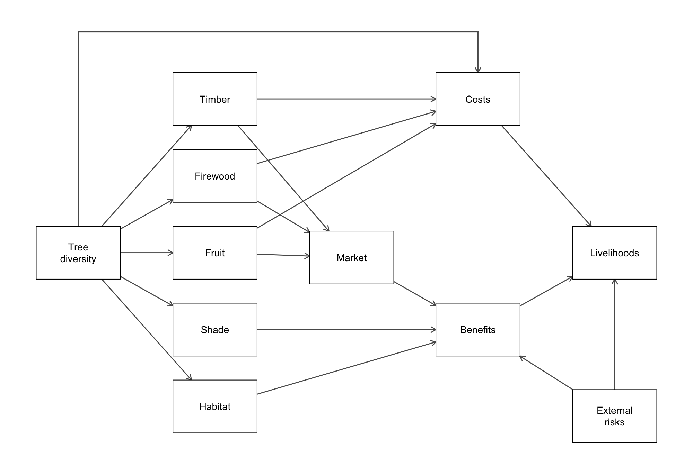

<!-- README.md is generated from README.Rmd. Please edit that file -->

```{r setup, include = FALSE}
knitr::opts_chunk$set(echo = FALSE, comment = "#>")
det <- read.csv("results/detectability.csv")
rej <- read.csv("results/rejection_when_not_real.csv")
ex <- read.csv("results/worked_example.csv")
num <- function(x) format(x, big.mark = ",", trim = TRUE)
sizes <- sort(unique(det$n))
typical <- function(d, col) round(100 * tapply(d[[col]], d$n, median)[as.character(sizes)])
kept <- typical(det, "power")
gone <- typical(rej, "rejected")
k <- ex$extra_numbers
```

# A BIC test on small samples rejects expert arrows that are real

Researchers often draw a causal diagram with experts and then test it against
data. The diagram is a directed acyclic graph (DAG): variables joined by arrows
from cause to effect. A common test keeps an arrow only if the diagram scores
higher with the arrow than without it, using the Bayesian information criterion
(BIC). We asked what that test can show, using one DAG of agroforestry and
livelihoods with 11 variables and 19 arrows.

**For a typical arrow in this DAG, samples of 500 records or fewer lead the test
to reject the arrow, whether or not the arrow is real.**

```{r claim}
knitr::kable(
  data.frame(num(sizes), kept, gone),
  col.names = c("Records", "Arrow is real: times kept (of 100)",
                "Arrow is not real: times rejected (of 100)"),
  align = "rrr", row.names = FALSE
)
```

Each value is the median over the 19 arrows. For a typical arrow, a rejection from a small sample therefore carries almost no
information.

## The DAG



The DAG was built from published studies of agroforestry and farm livelihoods,
and its conditional probabilities were set by expert judgment. Every
variable has two states.

## The test

We have no adequate field data, so we simulated records from known DAGs. One
record is one farm with a state for each of the 11 variables. For each arrow:

1. **Real arrow.** Simulate records from the DAG with its expert probabilities.
2. **Absent arrow.** Simulate records from the DAG without that arrow. Its
   probabilities are fitted to a very large sample from the expert's DAG.
3. In both cases, score the DAG with the arrow and the DAG without it on the same
   records. The higher BIC wins.
4. Repeat 100 times for each sample size.

## One arrow worked through

BIC is the log-likelihood of the records minus a penalty:

> BIC = log-likelihood − (ln *n* / 2) × number of probabilities estimated

Here *n* is the number of records, and a higher BIC is better. Take the arrow
`Market → Benefits`. With the arrow, `Benefits` has four causes and needs a
probability for each of 16 combinations of their states. Without it, `Benefits`
has three causes and 8 combinations. The arrow therefore costs `r k` extra
probabilities, a penalty of `r k / 2` × ln *n*. The arrow is kept only if it
raises the log-likelihood by more than the penalty.

```{r worked}
w <- det[det$from == "Market" & det$to == "Benefits", ]
w <- w[w$n %in% c(50, 100, 250, 500), ]
penalty <- k / 2 * log(w$n)
knitr::kable(
  data.frame(num(w$n), sprintf("%.1f", w$median_delta_bic + penalty),
             sprintf("%.1f", penalty), round(100 * w$power)),
  col.names = c("Records", "Median gain in log-likelihood", "Penalty",
                "Times kept (of 100)"),
  align = "rrrr", row.names = FALSE
)
```

The arrow is real in all four rows. The gain grows roughly in proportion to *n*,
the penalty only with ln *n*, so a large enough sample keeps the arrow.

## Records needed for each arrow

The table gives the smallest sample size we tried at which the test kept the real
arrow at least 80 times in 100, the usual power target.

```{r needed}
det$arrow <- paste0("`", det$from, " → ", det$to, "`")
needed <- sapply(split(det, det$arrow), function(x) {
  x <- x[order(x$n), ]
  if (any(x$power >= 0.8)) x$n[which(x$power >= 0.8)[1]] else Inf
})
needed <- sort(needed)
knitr::kable(
  data.frame(names(needed),
             ifelse(is.finite(needed), sapply(needed, num), "more than 5,000")),
  col.names = c("Arrow", "Records needed"), align = "lr", row.names = FALSE
)
```

The four arrows that need more than 5,000 records have little or no effect in the
expert probabilities. `Shade` has the same probability under high and low
`TreeDiversity`. The three arrows into `Costs` from `Firewood`, `Fruit` and
`TreeDiversity` each change the probability of high costs by at most 0.10.

## What this does not test

- Each comparison changes one arrow and takes the rest of the DAG as correct.
- Arrow direction is not tested. Two DAGs that differ in direction can have the
  same BIC.
- Records are independent, complete and free of recording errors.
- There are no unmeasured common causes.
- The sample sizes follow from these expert probabilities. Another DAG, or other
  probabilities, will need other sample sizes.

Real field data will break some of these assumptions, so treat the sample sizes as
a lower bound for planning, not a guarantee.

## Reproduce

`hcbic` is an R package. With R 4.1 or later:

``` sh
git clone https://github.com/CWWhitney/hill_climbing_bic
cd hill_climbing_bic
Rscript -e 'install.packages(c("bnlearn", "devtools", "rmarkdown", "knitr"))'
Rscript analysis/00_draw_diagram.R
Rscript analysis/01_power_of_the_test.R
Rscript analysis/04_arrows_that_are_not_real.R
Rscript -e 'rmarkdown::render("README.Rmd")'
```

[More results](docs/more_results.md) cover searching for a whole DAG by hill
climbing, recording errors, and 13 published studies. See also the
[review of version 1](docs/v1_critique.md) and `CITATION.cff`.
