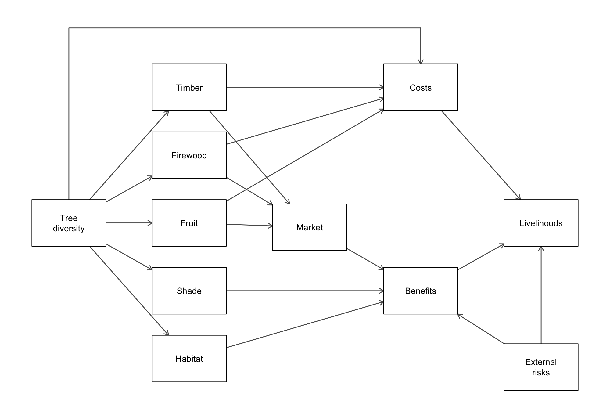

<!--
Draft of 27 November 2026. Render from the repository root:
  quarto render manuscript/preprint.qmd
All numbers come from results/*.csv (analysis/01 to 05) and R/expert_cpts.R.
OPEN before posting:
1. Who set the diagram and the probabilities, and how? Add the procedure to Methods.
2. P(Timber = Yes) is 0.80 under high and 0.99 under low tree diversity. Confirmed as
   intended (Cory, 27 Nov 2026). Add one sentence giving the reason; a reader will ask.
3. Read Dai, Korb, Wallace and Wu (1997) on weak links (not yet matched to a record).
4. Confirm the AI use statement.
5. Cite the large-sample theory of the likelihood-ratio test after reading it. Candidates
   (records found in Crossref, texts not read): Wilks 1938, doi:10.1214/aoms/1177732360;
   Wald 1943, doi:10.1090/S0002-9947-1943-0012401-3.
-->

```{r}
det <- read.csv("../results/detectability.csv")
rej <- read.csv("../results/rejection_when_not_real.csv")
rec <- read.csv("../results/recovery.csv")
imp <- read.csv("../results/improvements.csv")
wex <- read.csv("../results/worked_example.csv")
source("../R/expert_cpts.R")
cpts <- expert_cpts()
many <- read.csv("../results/random_arrows.csv")
expa <- read.csv("../results/expert_arrows.csv")
chk <- read.csv("../results/approximation_check.csv")
grid <- read.csv("../results/records_by_effect_and_causes.csv")
need <- function(i, k) format(grid$needed[abs(grid$information - i) < 1e-9 & grid$causes == k], big.mark = ",", trim = TRUE)
within <- function(k, n) round(100 * mean(many$needed[many$causes == k] <= n))

det$arrow <- paste(det$from, "→", det$to)
kept <- aggregate(power ~ n, det, median)
gone <- aggregate(rejected ~ n, rej, median)
k <- function(n) round(100 * kept$power[kept$n == n])
num <- function(x) format(x, big.mark = ",", trim = TRUE)
count80 <- function(n) sum(det$power[det$n == n] >= 0.8)
```

## Abstract {.unnumbered}

Researchers who draw a causal diagram with experts often want to test it against data. One test keeps an arrow only if the diagram has a higher Bayesian information criterion (BIC) score with the arrow than without it. We asked how the number of records this test needs depends on the size of the effect and on the number of causes of the affected variable. We used a large-sample approximation, applied it to `r format(nrow(many), big.mark = ",")` arrows in 1,000 random diagrams of binary variables, and checked it by simulation. The target was to keep a real arrow in 80 of 100 samples. With an effect size (conditional mutual information) of 0.01, one cause needed `r need(0.01, 1)` records and five causes needed `r need(0.01, 5)`. Among random arrows, `r within(1, 500)`% of those into a variable with one cause needed 500 records or fewer, against `r within(5, 500)`% with five causes. In an agroforestry diagram with 19 arrows, a typical real arrow was kept in `r k(500)` of 100 simulated samples of 500 records. We recommend computing the records needed for each arrow before collecting data.

## Introduction

Bayesian networks can combine expert knowledge with statistical data [@Heckerman_1995]. A Bayesian network is a directed acyclic graph (DAG), in which arrows run from cause to effect without forming loops, together with a probability table for each variable. Expert-built networks have informed, for example, analyses of how agricultural development policy may affect household nutrition [@Whitney_2018].

An expert diagram can be checked against data in several ways. One framework sets out kinds of validity to examine in expert-elicited networks [@Pitchforth_2013]. A diagram also implies independencies between variables that data can contradict [@Ankan_2021], and the number of violations can be compared with the number found after shuffling the variables among the nodes [@Eulig_2023]. A further approach scores diagrams with a criterion that rewards fit and penalizes the number of parameters, such as the BIC [@Schwarz_1978], and resampling can attach a measure of confidence to each arrow [@Friedman_1999].

Scores that penalize complexity need data to detect real arrows. Learning the correct structure needs more records than approximating the distribution of the variables [@Zuk_2006; @Friedman_1996]. For binary variables and the BIC, @Zuk_2006 separate the error of preferring a structure that cannot represent the true distribution from the error of preferring one with superfluous parameters, and find the first more likely in small samples. Sample size has also been studied by simulation for Bayesian structure discovery [@Koivisto_2006] and for other network models [@Constantin_2026].

A researcher planning a field test of an expert diagram needs to know which of its arrows a given number of records can address. We therefore ask how the records needed to keep a real arrow depend on the size of its effect and on the number of causes of the affected variable, across many diagrams, and apply the answer to a diagram of agroforestry and livelihoods. The general tendency of the BIC to miss arrows in small samples is established [@Zuk_2006]; our aim is a calculation that a researcher can repeat for each arrow of a diagram.

## Methods

### The one-arrow test

For a sample of $n$ records, the score of a diagram is

$$\text{BIC} = \ell - \frac{\ln n}{2}\, p ,$$

where $\ell$ is the maximized log-likelihood and $p$ is the number of free probabilities. A higher score is better. The test compares a diagram with the same diagram less one arrow, and keeps the arrow if the score is higher with it. All variables here have two states, so an arrow into a variable with $k$ causes (the tested cause included) adds $d = 2^{k-1}$ probabilities. The arrow is kept when twice the gain in log-likelihood, $G$, exceeds $d \ln n$.

### Effect size and records needed

We measured the effect of a cause $X$ on a variable $Y$, given the other causes $Z$ of $Y$, by the conditional mutual information $I(X;Y \mid Z)$, in natural units. $I$ is the expected gain in log-likelihood per record. It is zero when $X$ makes no difference, and it averages over the states of the other causes. For example, take a single cause present on half of all farms. $I$ is about 0.01 if the cause raises the probability of the effect from 0.43 to 0.57, and about 0.1 if it raises it from 0.28 to 0.72.

In large samples we treated $G$ as noncentral chi-squared with $d$ degrees of freedom and noncentrality $2nI$. The probability of keeping the arrow is then the probability that this variable exceeds $d \ln n$. We call the smallest $n$, of at least 10, from which this probability stays at 0.8 or higher the number of records needed. It was computed to within about 2%.

### Many diagrams

We generated 1,000 random diagrams of 11 binary variables placed in a causal order. Each variable drew between none and five causes from the variables before it, with each number equally likely where possible. Each probability was drawn uniformly between 0.05 and 0.95. For every arrow we computed $I$ exactly, from all states of the diagram, and then the records needed.

### Check of the approximation

For up to 300 arrows at each number of causes, among those needing at most 100,000 records, we simulated 1,000 samples of the predicted size and counted how often the test kept the arrow. An accurate approximation gives a share near 0.8.

### Agroforestry diagram and probabilities

The diagram links tree diversity on farms to livelihoods through products, markets, costs, benefits and external risks (@fig-dag). Each of the 11 variables has two states. The diagram was drawn with reference to published studies of agroforestry and farm livelihoods. Its probability tables are judgments, not estimates from data. One judgment runs against a simple expectation: timber is more probable under low tree diversity (0.99) than under high tree diversity (0.80).

{#fig-dag width=85%}

### Simulation of the agroforestry diagram

A record is one simulated farm with a state for every variable. For each arrow we ran two experiments. In the first, records came from the diagram with its judged probabilities, so the arrow was real. In the second, records came from the diagram without the arrow, with probability tables fitted to 200,000 records drawn from the full diagram (with a prior weight of one record), so the arrow was absent. We applied the test to 100 samples at each of 13, 50, 100, 250, 500, 1,000 and 5,000 records. A share estimated from 100 trials has a standard error of at most 5 percentage points. We call the smallest of these sample sizes at which a real arrow was kept in at least 80 trials the number of records needed.

### Search for the whole diagram

As a further analysis, we asked how much of the diagram a hill-climbing search recovers. The search starts with no arrows and adds, removes or reverses one arrow at a time while the BIC improves. We ran it on 100 samples at each sample size, without other information and again with arrows that run against the expert's causal order forbidden. To mimic recording errors, we also repeated the search with 5% and with 10% of values misrecorded.

### Software

We used R `r paste(R.version$major, R.version$minor, sep = ".")` with the packages `bnlearn` [@Scutari_2010], version `r packageVersion("bnlearn")`, and `hcbic`, version 2.0.0, with random seed 20261124.

## Results

### Effect size and number of causes

Records needed rose steeply as the effect became smaller and as the number of causes grew (@tbl-grid). A tenfold smaller effect, from 0.01 to 0.001, raised the records needed for one cause from `r need(0.01, 1)` to `r need(0.001, 1)`. At an effect of 0.01, five causes needed `r need(0.01, 5)` records, against `r need(0.01, 1)` for one cause. @fig-many places the arrows of the agroforestry diagram on the same scale.

```{r}
#| label: tbl-grid
#| tbl-cap: "Records needed to keep a real arrow with probability 0.8, from the large-sample approximation."
w <- xtabs(needed ~ information + causes, grid)
tab <- data.frame(as.numeric(rownames(w)), matrix(format(c(w), big.mark = ",", trim = TRUE), nrow(w)))
names(tab) <- c("Effect size I", "1 cause", paste(2:5, "causes"))
knitr::kable(tab, align = "rrrrrr")
```

Simulation agreed with the approximation. At the predicted number of records, the median share of samples keeping the arrow was between `r round(min(tapply(chk$power, chk$causes, median)), 2)` and `r round(max(tapply(chk$power, chk$causes, median)), 2)` across numbers of causes, and 90% of all checked arrows lay between `r round(quantile(chk$power, 0.05), 2)` and `r round(quantile(chk$power, 0.95), 2)`.

### Random diagrams

Arrows in random diagrams differed widely in effect size, and so in the records they needed (@tbl-many; values from the approximation). Arrows into variables with five causes rarely needed 500 records or fewer, although their effects were not smaller.

```{r}
#| label: fig-many
#| fig-cap: "Records needed against effect size. Lines are the approximation for one cause (lowest) to five causes (highest), and points are arrows of the agroforestry diagram. Arrows with an effect size below 0.0001 are not shown."
#| fig-width: 6.5
#| fig-height: 4.5
plot(NA, log = "xy",
     xlim = c(1e-4, 0.5), ylim = c(10, 1e6), xlab = "Effect size I (log scale)",
     ylab = "Records needed (log scale)")
source("../R/power.R")
x <- 10^seq(-4, log10(0.5), length.out = 60)
for (j in 1:5) lines(x, sapply(x, records_needed, causes = j), lty = j)
points(expa$information[expa$information >= 1e-4], expa$needed[expa$information >= 1e-4], pch = 16)
legend("topright", bty = "n", lty = 1:5, legend = paste(1:5, c("cause", rep("causes", 4))))
```

```{r}
#| label: tbl-many
#| tbl-cap: "Arrows of 1,000 random diagrams, by the number of causes of the affected variable. Records needed are from the approximation."
by <- split(many, many$causes)
knitr::kable(data.frame(
  Causes = names(by),
  Arrows = num(sapply(by, nrow)),
  "Median effect size" = sprintf("%.3f", sapply(by, function(a) median(a$information))),
  "Median records needed" = num(sapply(by, function(a) median(a$needed))),
  "Needing 500 or fewer (%)" = sapply(1:5, within, n = 500),
  "Needing 5,000 or fewer (%)" = sapply(1:5, within, n = 5000),
  check.names = FALSE), row.names = FALSE, align = "rrrrrr")
```

### The agroforestry diagram: real and absent arrows

A typical real arrow was rejected in most trials up to 500 records (@tbl-main). A typical absent arrow was rejected in nearly every trial at all sample sizes. The lowest share of rejections for any single absent arrow was `r round(100 * min(rej$rejected))` of 100, at `r rej$n[which.min(rej$rejected)]` records.

```{r}
#| label: tbl-main
#| tbl-cap: "Outcomes of the one-arrow test. Each value is the median over the 19 arrows."
knitr::kable(data.frame(
  Records = num(kept$n),
  "Real arrow kept (of 100)" = round(100 * kept$power),
  "Absent arrow rejected (of 100)" = round(100 * gone$rejected),
  "Real arrows kept at least 80 times (of 19)" = sapply(kept$n, count80),
  check.names = FALSE), align = "rrrr")
```

### One arrow worked through {.unnumbered}

The arrow from market to benefits adds `r wex$extra_numbers` probabilities, because benefits has four causes with the arrow and three without it. The penalty is therefore `r wex$extra_numbers / 2` × ln *n*. In large samples the arrow raised the log-likelihood by `r round(wex$gain_per_record, 3)` per record. The gain grew roughly in proportion to *n* and the penalty only with ln *n*, so the share of trials keeping the arrow rose with sample size (@tbl-worked).

```{r}
#| label: tbl-worked
#| tbl-cap: "The test for the arrow from market to benefits, which is real in every row."
m <- det[det$from == "Market" & det$to == "Benefits" & det$n %in% c(50, 100, 250, 500), ]
pen <- wex$extra_numbers / 2 * log(m$n)
knitr::kable(data.frame(
  Records = m$n,
  "Median gain in log-likelihood" = round(m$median_delta_bic / 1 + pen, 1),
  Penalty = round(pen, 1),
  "Times kept (of 100)" = round(100 * m$power),
  check.names = FALSE), align = "rrrr")
```

### Records needed for each arrow

In simulation, the number of records needed ranged from 13 to more than 5,000 (@tbl-arrows). Arrows from tree diversity to firewood, habitat, fruit and timber needed 100 records or fewer. Four arrows were still rejected in more than 20 of 100 trials at 5,000 records. Their causes change the probability of the effect by little or nothing. The approximation gave a finer value. It fell between the largest sample size that failed and the smallest that succeeded for every arrow but two, where it lay about 5% above the latter.

```{r}
#| label: tbl-arrows
#| tbl-cap: "Records needed to keep each real arrow in 80 of 100 samples. The simulated value is the smallest sample size tried that reached this. The largest change is the largest difference that the cause makes to the probability of the first state of the effect, over all states of the other causes."
change <- function(from, to) {
  a <- cpts[[to]]
  if (is.null(names(dimnames(a)))) return(NA)
  first <- do.call(`[`, c(list(a, 1), rep(list(TRUE), length(dim(a)) - 1), drop = FALSE))
  i <- match(from, names(dimnames(a)))
  d <- apply(first, seq_along(dim(first))[-i], function(x) abs(diff(x)))
  max(d)
}
arrows <- unique(det[, c("from", "to", "arrow")])
arrows$need <- sapply(arrows$arrow, function(a) {
  x <- det[det$arrow == a & det$power >= 0.8, "n"]
  if (length(x)) min(x) else Inf
})
arrows$change <- mapply(change, arrows$from, arrows$to)
arrows <- arrows[order(arrows$need, arrows$arrow), ]
e <- expa[match(arrows$arrow, paste(expa$from, "→", expa$to)), ]
knitr::kable(data.frame(
  Arrow = arrows$arrow,
  Causes = e$causes,
  "Largest change" = sprintf("%.2f", arrows$change),
  "Effect size I" = sprintf("%.4f", e$information),
  "Approximation" = ifelse(is.finite(e$needed), num(signif(e$needed, 2)), "never"),
  "Simulated" = ifelse(is.finite(arrows$need), num(arrows$need), "more than 5,000"),
  check.names = FALSE), row.names = FALSE, align = "lrrrrr")
```

### Search for the whole diagram

```{r}
r500 <- rec[rec$n == 500, ]
s <- function(label) imp[imp$setting == label & imp$n == 500, ]
found <- function(x) round(19 * x$recall)
wrong <- function(x) round(100 * (1 - x$precision))
base <- s("search with no help"); ord <- s("order of causes given")
e5 <- s("5% of values misrecorded"); e10 <- s("10% of values misrecorded")
```

With 500 records and no other information, hill climbing found on average `r found(base)` of the 19 arrows with the correct direction, and `r wrong(base)` of every 100 arrows it drew were wrong. Giving the order of causes raised the number found to `r found(ord)` and lowered the wrong arrows to `r wrong(ord)` per 100. Misrecording 5% of values lowered the number found to `r found(e5)`, and misrecording 10% to `r found(e10)`.

## Discussion

The records a BIC test needs depend on the effect averaged over all records and on the number of probabilities the arrow adds. Both are known once a diagram has probability tables, so a researcher can compute them from elicited tables before collecting data. The largest change that a cause makes to the probability of an effect is a poor substitute: an effect that appears under only one combination of the other causes is diluted over all records. We suggest reporting which arrows the planned sample can address and describing the remaining arrows as untested.

For the agroforestry diagram, a few hundred records are enough to test the strongest arrows and too few to test most of the others. A rejection of a typical arrow from such a sample should not be read as evidence against the experts, because the same outcome is expected whether the arrow is real or absent. The pattern agrees with the finding that the BIC more readily omits a real arrow than adds a false one in small samples [@Zuk_2006].

The causal order of the variables is knowledge that experts can often state, and supplying it to the search removed most wrong arrows in our simulations. Other studies combine knowledge with data inside the score itself [@Heckerman_1995], which our comparison does not do.

The analysis has limits. All variables have two states, and the random diagrams share one size, one limit on the number of causes and uniformly drawn probabilities; judged probabilities may give weaker or stronger effects. The computed records depend on elicited tables that may be wrong. The records come from the judged probabilities or from tables fitted to them, so the sample sizes describe a favorable case: independent, complete records and no unmeasured common causes. Each comparison changes one arrow and takes the rest of the diagram as correct. Arrow direction is not tested by the one-arrow comparison, and diagrams that differ only in the direction of some arrows can have equal scores. The agroforestry sample sizes belong to these probabilities. The diagram has not been tested against field data.

## Conclusion

The records needed to keep a real arrow grow quickly as its effect shrinks and as the affected variable gains causes. Computing them for each arrow shows which parts of an expert diagram a planned survey can test.

## Code availability {.unnumbered}

The R package and analysis scripts are at <https://github.com/CWWhitney/hill_climbing_bic> under the MIT license.

## Use of AI {.unnumbered}

The author used Claude (Anthropic) to draft this manuscript from the repository's code and results. The author is responsible for the content.

## References {.unnumbered}

::: {#refs}
:::
